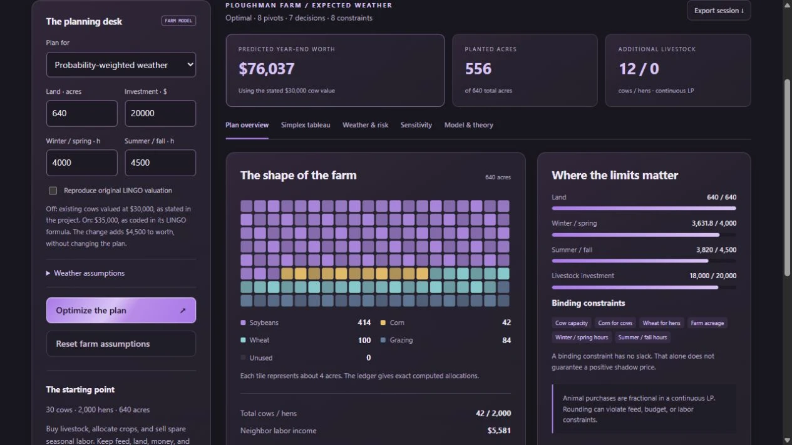

# OR Tableau Studio

An interactive operations research workbench by Michael Harris. Turn a farm-management linear program into a visual plan, inspect every simplex pivot, compare weather outcomes, and explore local sensitivity. Runs entirely in your browser with no dependencies, accounts, backend, or telemetry.

**[Launch the app](https://surfingcoder.com/apps/or-tableau-studio/)** · **[Browse SurfingCoder](https://surfingcoder.com/)**



## Run locally

Use Python 3 to serve this directory:

```sh
python -m http.server 8000 --bind 127.0.0.1
```

Open `http://127.0.0.1:8000`. ES modules require HTTP; opening `index.html` through `file://` is not supported. There is no installation or build step.

Use Node.js 20 or newer for tests:

```sh
node --test
node --check app.js
```

## Explore

- **Planning desk:** change acreage, investment, seasonal labor, crop values, probabilities, or the target weather; then choose **Optimize the plan**. Reset restores the project dataset.
- **Plan overview:** see crop/grazing allocations, resource use, livestock decisions, and reduced costs. Mosaic tiles approximate acreage; the ledger gives computed values.
- **Simplex tableau:** step forward/backward, scrub the trace, and inspect the entering column, leaving row, pivot element, and ratio test. Fraction display approximates floating-point values.
- **Weather & risk:** evaluate one fixed plan under all six scenarios, compare scenario-optimal plans, and distinguish expected value from perfect foresight.
- **Sensitivity:** inspect shadow prices, objective coefficient intervals, and RHS feasibility intervals for the selected optimal basis.
- **Model & theory:** solve your own JSON model; start with workshop, minimum-cost blend, infeasible, or unbounded examples. Supports maximization/minimization, mixed `<=`, `>=`, and `=` constraints, and nonnegative continuous variables.
- **Export session:** download model, results, trace, and optional farm settings. Import a raw model or exported session JSON to re-solve its `model` as a custom LP. Imported farm metadata does not repopulate the planning desk; use Reset to return to farm mode. Imports stay local.

## Model JSON

```json
{
  "sense": "max",
  "names": ["Boards", "Benches"],
  "c": [40, 30],
  "constant": 0,
  "constraints": [
    {"name": "Wood", "a": [2, 1], "op": "<=", "b": 40},
    {"name": "Workshop hours", "a": [1, 2], "op": "<=", "b": 50}
  ]
}
```

This example yields Boards = 10, Benches = 20, objective = 1,000. Names are optional and must be unique when supplied. Limits: 1–12 variables, 1–24 constraints, coefficient magnitude ≤ 100 million, JSON file ≤ 200 KB. Variables must be nonnegative; free variables and integer constraints are not supported.

## Relationship to the original project

Inspired by the MAP6106 farm-management project by **Michael Harris, Sean Young, and Alexandros Dimitriadis**. The original document is not distributed. This is a new implementation, not a LINGO wrapper. See [the mathematical model](docs/model.md) and [solver design](docs/solver.md).

The project prose values existing cows at $30,000, but its LINGO objective uses $35,000. The default follows the prose; **Reproduce original LINGO valuation** reproduces the coded objective. The difference is a fixed $4,500 after 10% depreciation and does not change decisions. Tests reproduce all six coded weather optima and the coded expected-value optimum of $80,537; the default corrected expected worth is $76,037.

The app recomputes full-precision payoff values and basis ranges instead of copying rounded output or the document's sensitivity conclusions. It does not round fractional livestock into a purported valid integer plan.

## Implementation and validation

`src/simplex.js` implements two-phase primal simplex with Bland's rule. `src/farm.js` defines the dataset and scenario evaluation. `app.js` renders the workbench; `theme.css` uses SurfingCoder's Amethyst & Graphite palette. `test/solver.test.js` covers known primal/dual solutions, sensitivity, redundant equalities, negative RHS, infeasible/unbounded status, the classic cycling example, project regressions, and 80 deterministic random 2D models checked by independent vertex enumeration. GitHub Actions runs the same tests.

Educational floating-point arithmetic uses an absolute pivot tolerance of 1e-9 and a scaled feasibility check. It is intended for small, reasonably scaled models. It does not certify exact rational results, global robustness to coefficient error, or integer-optimal decisions. Degeneracy can produce different valid optimal bases and local ranges. Re-optimize after simultaneous changes.

## Publish and maintain

The public source is `netcodermike/or-tableau-studio`. The live demo is a static copy under `apps/or-tableau-studio/` in `netcodermike/surfingcoder`; publish source changes and refresh that copy together. No original school files, transcripts, or private data belong in either repository. Screenshots show the running app with its academic example dataset.

MIT License applies to this implementation. Mathematical reference: [MIT, Solving Linear Programs](https://web.mit.edu/15.053/www/AMP-Chapter-02.pdf).
